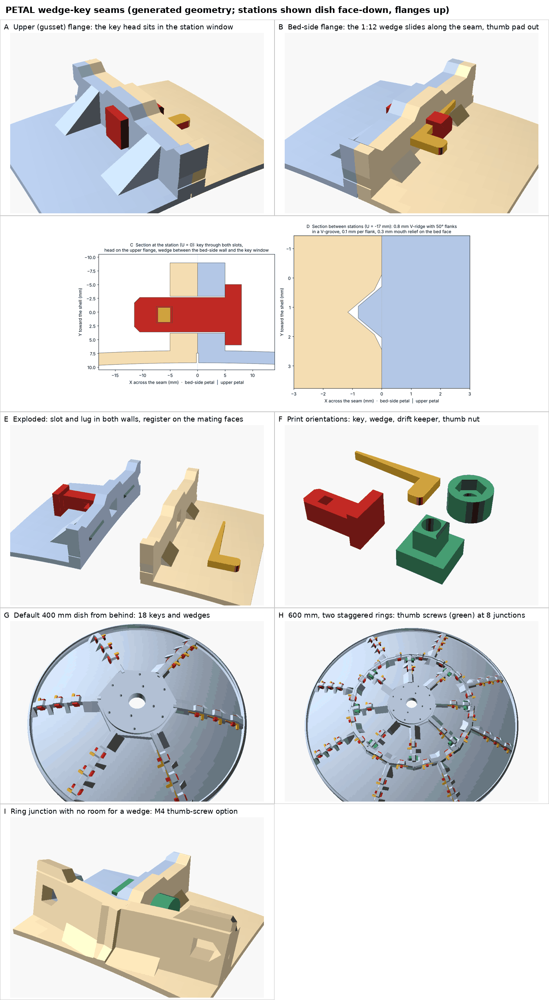

# Wedge-key seams (tool-less)

A seam fastening mode that needs no tools and no hardware. A printed T-key goes through a slot in both seam flanges and a printed 1:12 wedge, pushed along the seam by thumb, draws the two walls together. A V-ridge on one mating face and a V-groove in the other line the petals up. All the images on this page are rendered from meshes the generator makes (OpenSCAD for the views, matplotlib for the sections).

## Why

Printed snap clips do not hold a dish of warped petals together. A clip stores almost no energy: it clamps with about 5–6 N per jaw at its nominal 0.05 mm squeeze, anywhere from 0 to about 30 N across ±0.2 mm of print error, and its detent lets go at about 35–50 N. Pulling a 1–2 mm bow out of a 150 mm flange takes roughly 50–240 N and 1.5–2 mm of draw. No printed spring can store that. Bolts work because a thread is a positive drive with unlimited draw and a rigid stop: the bent petal is the spring. The wedge key keeps that principle and drops the tools. Two independent design studies reached the same conclusion; this mode implements their combined recommendation.

## In the app

Choose **Connections → Wedge keys · tool-less**, or set it for one seam family or one joint under **Edit individual joints**. The petals get the clip/lever stations (same count and pitch, 5 mm flat walls, gusset windows) with a slot, a lug and the register. The kit adds a key and a wedge for every station plus spares (installed + max(2, 10 %)). It also adds two printed parts for the thumb-screw option: one set for each station that needs it, plus two spare sets. The assembly view shows every set installed. The clip-fit inputs stay disabled in this mode, and **Seam bolt** is hidden, because the slot does not depend on it.

| | |
|---|---|
| Slot | 6.4 mm (along the seam) × 6.7 mm, through both walls, centre 0.5 mm above the station level. Where a ceiling of the slot would face down more than about 43° in the side print, the slot gets a 90° gable toward print-up, built like the round bores' roofs. The bed-side radial flange's slot is vertical in print and needs none |
| Lug | Both walls are 3 mm deeper under the slot, over ±10 mm along the seam with 45° ends. Where a wall's outer face looks down in the side print (the upper radial flange of 8 or more petals), the lug's outer edge is chamfered 45° below its first millimetre, continuing the gusset line |
| T-key | 6.0 × 6.3 mm shank, 0.2 mm per side in the slot. An L-shaped head, 3 × 11 × 10 mm, bears on the upper flange inside the gusset window. A 3.0 mm window in the tail starts 2.5 mm beyond the bed-side wall's outer face, with a 4 mm tail beyond it and 1 mm lead-in chamfers. Net section 20 mm² |
| Wedge | A 2.7 mm plate: 0.9 mm tip, a 1:12 taper (4.8°) over 24 mm to 2.9 mm, then a thumb pad standing 11 mm out from the wall and 5 mm long. It closes a gap of up to 1.6 mm at a station, with 0.4 mm in reserve. The pad meets the key's tail when the reserve is used up |
| Register | Ridge 0.8 mm high with 50° flanks and a 0.4 mm flat top on the upper flange's mating face. Groove with 0.1 mm per flank, a V bottom (no bridged floor) and a 0.3 mm × 0.25 mm mouth relief for first-layer flare in the bed-side face. Straight segments between the stations |
| Thumb-screw option | Same slot. An M4 × 20 hex-head bolt sits in a hex pocket in a printed drift keeper (its boss is the key's section and enters the far slot 1 mm). An M4 nut is pressed into a printed Ø12 × 7 mm knurled thumb nut, with an M4 × 12 mm OD washer under it |

### How the station dimensions were chosen

- **Slot height position.** With the slot centred at Y = +0.5 (the shell's underside is at Y = 7), 3.15 mm of wall stays above the slot. Below it, on the default dish's stations (tilted 17.5°, 22.6° and 27.3° along the seam), the wall has 3.5, 3.1 and 2.6 mm; the 3 mm lug makes that 6.5, 6.1 and 5.6 mm. The key head's top is then 1 mm under the shell, and the wedge (Y −0.85 to +1.85) passes under the bed-side flange's 4 mm fillet, which starts 3 mm above the slot centre. Inside the station window the fillet is cut away anyway, for the key's tail.
- **Shorter than the study's wedge.** The study's wedge had a 2 mm flat and a 6 mm tab after the taper, about 32 mm overall. At the clip pitch (about 34 mm along the seam on the default dish) neighbouring wedges would touch. Starting the pad at the end of the taper saves 2 mm and gives a positive stop. With a 5 mm pad, a seated wedge spans 29 mm.
- **Parts symmetric about the slot centre.** Key, wedge, keeper and thumb nut are all mirror-symmetric in Y about the slot centre. So turning a set end for end (180° about the slot axis) is the same as mirroring it along the seam: one printed part serves both directions. The generator also uses this symmetry to keep every installed instance a proper rotation, so the viewer and the PDF never draw inside-out parts.

### Why the register is in straight segments

The final petal slides in radially. During the last vh / sin h of its travel, the ridge is already inside the groove, but the petal is still (remaining travel) · cos h out along the seam (h = π/n, vh the ridge height). A ridge that follows the shell along a seam rising at angle t is therefore offset across its flanks by (remaining travel) · cos h · sin t. The 50° flanks open by (remaining travel) · sin h / tan 50°. So such a ridge slides in only while sin t ≤ tan h / tan 50°. That holds for 6 petals, just: tilts reach about 28° and the limit is 29°. It fails for 8 or more petals, where the generator's own radial-insertion test would collide by several tenths of a millimetre. A continuous ridge above the slots would have to follow the shell, so it is ruled out for most dishes.

Each segment is therefore a straight prism in the seam plane, tilted from horizontal by β = min(shell slope, asin(0.9 · tan h / tan 50°)): 25.8° for 6 petals, 18.2° for 8, 14.2° for 10, 8.6° for 16. A segment flatter than the shell crosses the wall's depth, so it fits only between the stations. That makes the register segmented. The segments keep clear of every slot (with a gable on either side) by 2 mm, of the wall bottom by 1.5 mm and of the shell by 1 mm. A horizontal segment registers the dish-axis direction, which at a radial seam is the reflector step. The groove is longer than the ridge by e = vh / tan h + 1 mm at each end, the lead-in for the slide (2.4 mm for 6 petals, 5.0 mm for 16). Ring seams use vh · tan(h/2) + 1 mm, because the outer petal approaches them almost head-on. On the default dish each radial seam carries ridges of 25.0, 12.8 and 13.7 mm. Both flanges of a seam compute the same segments: they use the shallower of the two walls and the same slot allowance.

### Ring junctions

Each set is probed with its wedge 2 mm either side of its seated position (print tolerance and seating). The probe runs against the assembled petals and against the sets already placed. Along each seam the orientations are chosen together, fewest thumb-screw stations first and fewest turned sets second. A set that would hit a neighbouring flange is turned end for end. Where neither direction fits, the station takes the thumb-screw option, shown installed, and HARDWARE.csv says how many. The key-head/keeper envelope and the key-tail/thumb-nut envelope are cleared from neighbouring flanges where seams meet, as the clip and bolt seats are. Those cuts are roofed toward print-up so they leave no ceiling. Examples: the default dish has 18 stations, all wedges. A 600 mm dish in two staggered rings has 56 stations: 48 wedges and 8 thumb screws (the outer station of each inner-ring radial seam, 17 mm from the junction). An 800 mm dish with 16 × 2 petals has 128 stations: 112 wedges (32 end for end) and 16 thumb screws.

## Assembly

1. Lay the petals face-down on a soft, flat surface, flanges up. Remove first-layer flare from the mating faces and the groove mouths only.
2. Bring each petal to its neighbour so the ridges on its upper flange drop into the grooves of the bed-side flange. Slide outer petals in radially.
3. At every station, push a key through both slots from the upper (gusset) flange, head into the window.
4. Push each wedge through the window in the key's tail, thin end first along the seam, and press it finger-tight with the thumb on its pad. Do not hammer it.
5. Close the ring with the final petal, sliding it in radially; ridge and groove engage over its last few millimetres. Then fit its keys.
6. Tighten the seams in opposite pairs, from the hub to the rim: re-press each wedge, then the ones on the opposite seam. Check the step across each seam with a straight edge as you go.
7. After a warm hold (a few hours in the sun, or 1 h at about 50 °C), re-press every wedge. Printed plastic settles.

**Release:** push each wedge back out by its thin end (a fingernail or a coin on the tip), pull the key, and slide the petal out radially.

## Printing and materials

Everything prints as exported, without supports: the key on its side so the pull runs along the layers, the wedge flat, the drift keeper on its outer face, the thumb nut with its pocket up. Print keys and wedges in PETG, PCTG or ASA with at least four perimeters. Do not use a carbon-filled grade for the wedge: its taper face must slide and hold.

`scripts/check-printability.py` finds no unsupported overhangs on these parts. It reports one 7.2 mm bridge over the keeper's hex pocket. It also finds none on wedge-key petals of the default dish, a 600 mm two-ring dish, the 0.25 f/D dish or a 1200 mm 10-petal dish. Clip-mode petals of that 1200 mm dish have 1,700 mm² of overhangs. On a 16-petal dish both modes share the window-face ceilings of the upper flange, which come from the existing 5 mm-wall window design. The groove's mouth relief prints as a first-layer ledge.

## Same-slot alternatives

- **M4 thumb screw:** the hex head goes in the keeper's pocket on the upper flange; the nut is pressed into the thumb nut on the bed-side flange. Finger-tight gives roughly 250–500 N with unlimited draw. It is required where a wedge does not fit, and is useful at any station of a badly warped petal. The kit always prints two spare keepers and thumb nuts.
- **Cable tie:** a 3.6 mm UV-stabilised PA66 tie through both slots and around both flange bottoms (the lug) gives about 100–200 N. Replace it yearly.

## Fit test

`FIT_TEST` has two seam strips cut from the real petals around a station (with a register segment), keys at 0.15, 0.20 and 0.25 mm slot clearance per side, wedges at 1:10, 1:12 and 1:15 plus a 1:12 wedge with optional click bumps, and shims 0.5, 1.0 and 1.5 mm thick (1, 2 and 3 notches). Its README gives the procedure:

1. Hand fit.
2. Draw: with the 1.0 mm shim at the far end of the strips, the station closes to 0.1 mm or less by thumb.
3. Clamp: the back-out force divided by 0.3.
4. Step: 0.1 mm or less.
5. Self-locking: after taps and 1 h at 55 °C, 0.5 mm or less of wedge creep.
6. Cycles: 20 assemblies without whitening.

## Limits

- Not load-rated. Every force on this page is a hand calculation (a 50–80 N thumb push gives roughly 70–165 N per station; self-locking because 4.8° is below the 7–17° friction angle), not a test. Nothing here has been printed or measured yet.
- The keys can draw out typical warp, a bow of up to about 1–1.5 mm along a seam (at most 1.6 mm at a station). They cannot fix waviness shorter than about 75 mm, a curled corner beyond the last station, or a ring that will not close because each petal's angle is off. Fix warp and angle errors at the printer first: Z-scale compensation, brim, enclosure ([PRINTING-LARGE-PETALS.md](PRINTING-LARGE-PETALS.md)). Pulling a bow flat stresses the shell and can move the reflecting surface, so measure it.
- A horizontal register segment fixes the dish-axis offset between neighbours. The along-seam offset is held only by the key in its slot (±0.2 mm), so on a seam tilted by t the surface step can still be off by up to that offset × tan t (about 0.1 mm at 28°).
- The click-bump wedge is a fit-test option. Its bumps ride over the key window under the full stack stiffness, so they act as a ratchet rather than a light click.

## Verification in the repository

`tests/structure.test.mjs` builds the default dish and a 600 mm two-ring staggered dish in this mode and checks:

- closed, connected solids and bed fit
- packing clearance and the final petal's sampled radial insertion between fixed neighbours
- cross-ring mating
- every installed key and wedge clear of the assembled dish, and bearing on its flange when pushed 0.3 mm toward it
- the key's section open through both walls at every station
- the register engaged: a petal shifted 0.06 mm along the dish axis stays clear of its neighbours, and shifted 0.4 mm its ridges bite their grooves
- the kit, fit-test parts, manifest and guide

`tests/connections.test.mjs` uses wedge keys as a ring-family and single-joint override. `scripts/check-ui.cjs` checks the method card.
