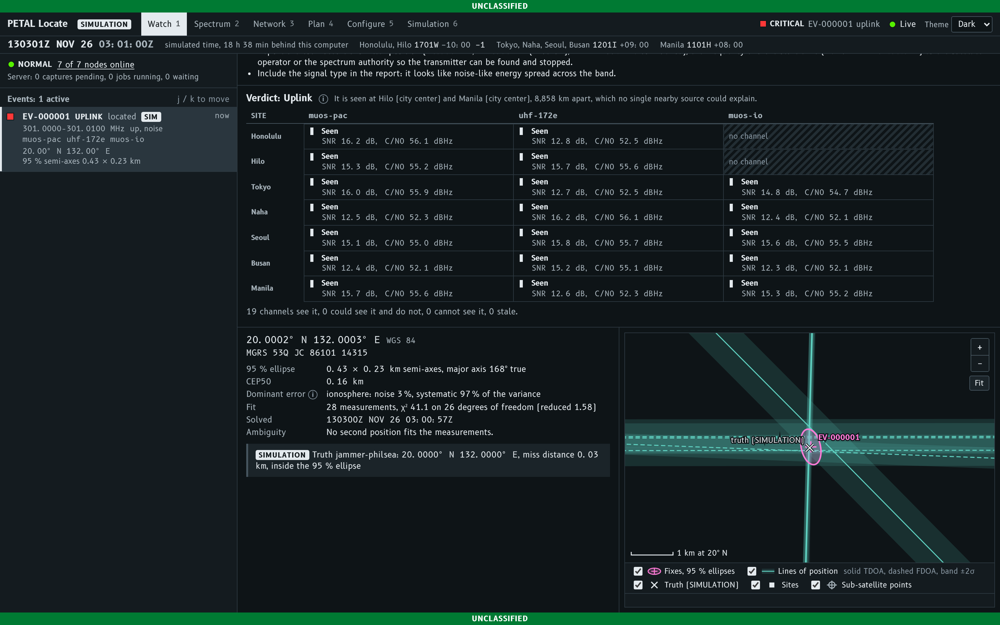

# PETAL Locate

PETAL Locate watches bent-pipe satellite transponders for interference with a network of
small ground sites, decides whether an interfering signal enters on the satellite uplink
(and so reaches everyone using that transponder) or only at one site's own receiver, and
locates uplink emitters on the ground from the time and frequency differences (TDOA and
FDOA) between the copies two or more satellites relay, calibrated against reference
transmitters at known places. Each site is an antenna (a PETAL 3D-printed dish or any
other), a software-defined radio and a node agent that streams spectrum to a central
server; the server raises events, asks the sites for coincident IQ captures, correlates
them, solves for position and serves an operator console. Satellites, transponders,
frequency plans, sites and antennas are all configuration.

**This is a proof of concept validated only against its own simulator.** Every number
and picture here is simulated with illustrative link parameters and nominal orbital
slots; nothing has been tested against real satellites or radios
([LIMITATIONS.md](docs/LIMITATIONS.md)).



## Quick start

From this directory (Linux, Python 3.11 or later):

```bash
python3 -m venv .venv
.venv/bin/pip install .
.venv/bin/petal-locate demo --port 0
```

The demo starts the server with the example configuration (`config/pacific-uhf.yaml`:
three UHF satellites, seven sites from Honolulu to Manila, two reference carriers) and
one simulated node process per site over real WebSockets, then prints the console
address, which carries the run's random API token:

```
PETAL Locate demonstration (SIMULATED data)
  Console:    http://127.0.0.1:41403/?token=QIgXBCytF0N6RFmn0yjXficoCAi10HRQ
  API token:  QIgXBCytF0N6RFmn0yjXficoCAi10HRQ (the address above carries it; enter it if the console asks)
  ...
All 7 nodes are online.
```

Open that address in a browser. A jammer in the Philippine Sea is detected within
seconds, judged an uplink signal and located: in the run above it was located 7.5 s after
it was first detected, 74 m from the simulated truth inside a 95 % ellipse with
semi-axes of 452 by 244 m. Other scenarios are loaded from the **Simulation** screen.
The simulated world follows the clock, so the geometry depends on the time of day;
`--start 2026-11-13T03:00:00Z` runs it from a fixed time instead. Ctrl-C stops the
server and every node. To deploy on real sites, see
[OPERATIONS.md](docs/OPERATIONS.md).

## What each demo scenario shows

All in `config/scenarios/`; the numbers are from the server's chain at eight times of
day (RESULTS.md sections 4.4 and 5). The scenarios have no ionosphere or troposphere,
while the solver allows for both, so their calibrated ellipses are cautious.

| scenario | the simulated world | what the operator should see |
|---|---|---|
| `pacific-demo` (default) | a 10 kHz noise jammer, 20 dBW, at 20 N 132 E on a channel all three satellites relay; small satellite, oscillator and clock errors | a new signal on every site, an uplink verdict within seconds, a fix calibrated against the Guam reference with a median miss of 0.13 km (at most 0.44 km) inside a 95 % ellipse with a semi-major of 0.47 to 0.61 km |
| `clock-fault` | the same, with the Naha site clock 10 us late | the same calibrated fix, and on the Network screen a caution on Naha's clock (about -10 us by calibration, the calibrations through two satellites agreeing); without calibration the fix would be about 31 km off (median), mostly outside its ellipse, with no warning from the fit |
| `ephemeris-error` | the jammer at 17 N 141 E while two satellites are 8 km and 6 km from where the server believes them | calibrated 0.13 km from the truth (median); uncalibrated 12 to 25 km off or worse; no clock caution, and the Network screen's site-clock notes name muos-pac and uhf-172e as probably mispositioned; the live solves then widen those two satellites' position sigma (8 and 9.5 times, sized from the calibrations) and the fix stays inside its ellipse (live from 03:00 and 15:00 UTC: inside in all 76 snapshots over 9.5 minutes each, 6 to 72 m off, 95 % semi-major 290 to 373 m), the advice saying the ellipse includes that allowance |
| `two-jammers` | a second jammer, 8 kHz, 18 dBW, at 30 N 135 E on the other shared channel | two separate events, each located (median miss 0.08 km and 0.10 km) |
| `uplink-cw` | an unmodulated carrier, 5 dBW, at 15 N 130 E | classification `cw`, uplink, FDOA only ("No TDOA: the signal is too narrow ..."); the first positions, from two FDOA rows, are shown as "not a fix"; a coarse calibrated fix (median miss about 16 km, 95th percentile 50 km) inside a very long ellipse once there are spare measurements |
| `uplink-swept` | a sawtooth chirp sweeping 10 kHz every 40 ms at 21 N 127 E | classification `swept`, uplink, the correlations ambiguous, no position, and a message saying why it cannot be located (fresh at 03:00 and 03:26 UTC; a calibrated pair whose window holds one peak can still locate it, roughly) |
| `local-interferer` | a weak terrestrial transmitter 4 km from Busan on a downlink frequency | seen only at Busan; verdict local ("Local interference at Busan", received near 260.005 MHz), advice to relocate, shield or filter there, no location attempt |
| `quiet` | only the two reference carriers | the references shown as authorized carriers, no events |

## What it can do (simulated)

From [RESULTS.md](docs/RESULTS.md), on the example configuration; every number is
simulated, with illustrative link parameters and nominal slots, and includes the
ionosphere (30 TECU) and the troposphere, which the solver carries as uncertainty:

- **Detection.** Every site detects an uplink jammer on any satellite it can see. With
  the 0.72 m PETAL dish a 10 kHz jammer needs about 11 dBW EIRP toward the satellite
  (15 dBW if it fills a 25 kHz channel); a 1.2 m dish detects jammers 3.0 to 3.7 dB
  weaker, a 10 dBi beam antenna 2.7 to 3.1 dB weaker. At these frequencies (wavelength
  about 1.15 m) the 0.72 m dish is a 3.3 dBi reflector with a beam about 110 degrees
  wide, not a focusing dish.
- **Location, operator-grade ephemeris.** Uncalibrated 95 % error ellipses with
  semi-axes of about 5 to 6 km by 0.6 to 0.9 km; Monte Carlo median miss 1.3 to 1.9 km.
  Calibrated against a reference transmitter: about ten times smaller, median miss 120
  to 320 m.
- **Location, TLE-grade ephemeris.** Uncalibrated about 23 km median miss; calibrated
  median miss 0.32 km near the reference and 0.88 km 1,500 km away, and a predicted 95 %
  semi-major of 4.4 to 24 km at about 3,000 km. Where the reference sits matters:
  650 km away in any direction from which it sees every satellite kept it to 1.2 to
  4.9 km.
- **Satellite position errors beyond the configured sigma** show in the reference
  calibrations (same-satellite clock checks name the satellite). The live solves widen
  that satellite's position sigma by a factor sized from those calibrations, so the
  ellipse covers the error instead of shrinking past it as rows pile up (live
  ephemeris-error: the truth inside in every snapshot, the ellipse 15 to 30 % larger
  than without the allowance). Errors the clock checks cannot see go uncovered
  (LIMITATIONS.md section 7).
- **The ionosphere** delays each UHF leg by roughly 0.45 to 1.7 microseconds on a
  typical day. The system does not predict it; it widens every ellipse to cover a
  stated level (`processing.uncertainty.iono_vtec_tecu`), which must match the region
  and season: at twice the assumed level the ellipses are too small.
- **Cannot:** locate a signal only one satellite relays; locate a CW jammer without
  calibration (calibrated, about 16 km median), nor quickly (a fit from too few rows
  is not a fix); locate a periodically swept jammer, as a rule (its correlations are
  ambiguous; only a pair whose search window holds a single peak measures it); always
  pick between two
  candidate positions without calibration.
- **Sites** buy redundancy and detection margin, not location accuracy: any one site
  with channels on all three satellites predicts within about 20 % of the seven-site
  network.

## Documents

| document | what it holds |
|---|---|
| [docs/OPERATIONS.md](docs/OPERATIONS.md) | deploying and running it: site hardware, install, configuration, server, nodes, console, calibration, the demo, troubleshooting |
| [docs/LIMITATIONS.md](docs/LIMITATIONS.md) | everything this proof of concept does not prove or do |
| [docs/RESULTS.md](docs/RESULTS.md) | the simulated capability study; raw numbers in `docs/results/*.json`, reproduced by `scripts/capability_study.py` |
| [docs/MATH.md](docs/MATH.md) | the measurement model and estimation (normative: signs, units, algorithms, tolerances) |
| [docs/ARCHITECTURE.md](docs/ARCHITECTURE.md) | modules, configuration model, simulator, server pipeline, CLI |
| [docs/PROTOCOL.md](docs/PROTOCOL.md) | the node-to-server and console-to-server wire protocols |
| [docs/CONTRIBUTING.md](docs/CONTRIBUTING.md) | rules for changing the code |
| [THIRD_PARTY.md](THIRD_PARTY.md) | the fonts and libraries bundled in the console build, with their license texts |
| [docs/UI-BRIEF.md](docs/UI-BRIEF.md), [ui/README.md](ui/README.md), [ui/DESIGN.md](ui/DESIGN.md) | the operator console: brief, build, design record |

More console screenshots: [watch](docs/images/watch.png),
[measurements and correlation](docs/images/event-measurements.png),
[spectrum](docs/images/spectrum.png), [accuracy planning](docs/images/plan-accuracy.png),
[configuration](docs/images/configure.png).

## Running the tests

With the development install of [CONTRIBUTING.md](docs/CONTRIBUTING.md):

```bash
OMP_NUM_THREADS=1 OPENBLAS_NUM_THREADS=1 .venv/bin/python -m pytest -q -p no:cacheprovider -m "not slow" tests/test_config.py tests/test_protocol.py
```

That subset ran 368 tests in 2.5 s. Leave out the file names for the whole suite;
leave out `-m "not slow"` to include the long statistical tests and the end-to-end
tests, which start the real demo from a fixed simulated time (`demo --start`, so the
outcome does not depend on the time of day; `tests/e2e/test_system.py`, several
minutes) and drive the console in Chromium with Playwright (`tests/e2e/test_console.py`;
skipped when Node, the console's dependencies or the browser are missing). The
console's own tests are in `ui/` (`npm test`, `npm run e2e`; see
[ui/README.md](ui/README.md)).
